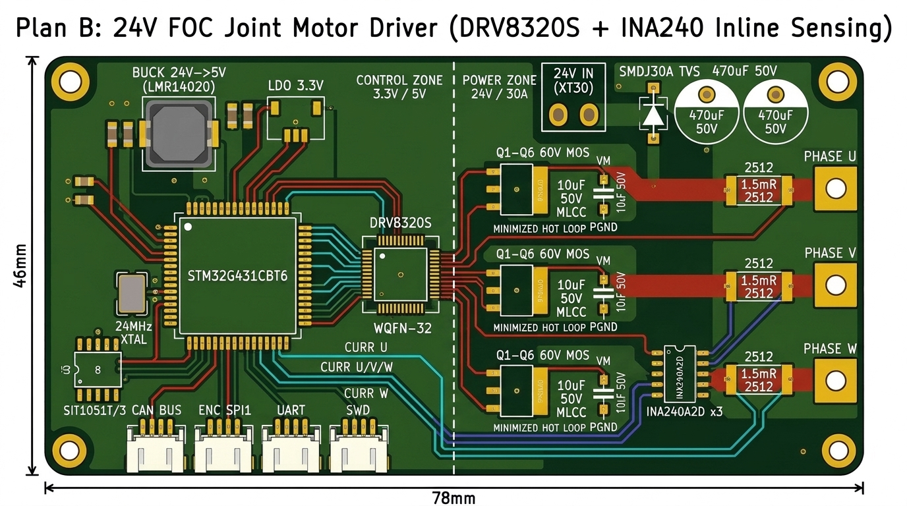
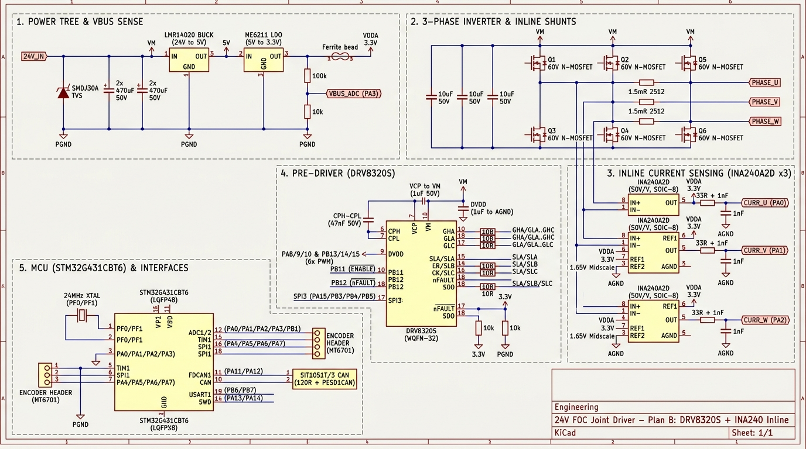

# 24V FOC 关节电机驱动板（5010 电机 · 四层长方形板）· 方案 B

> 整理自 Antigravity 对话（2026-11-26）。最终方案：`STM32G431CBT6` + `DRV8320S` + `INA240A2D` 相线串联采样 + 6×60V MOS。

## 目录
1. [方案 B 元器件参数、引脚分配与防翻车细节](#part1)
2. [方案 B PCB 布局图与原理图](#part2)
3. [立创商城配单核对表与投板自检清单](#part3)

---

## 一、方案 B 元器件参数、引脚分配与防翻车细节

选 **方案 B（`STM32G431CBT6` + `DRV8320S` + `INA240` 相线串联采样）** 非常明智——这是目前高精度机器人关节驱动器最舒服的架构，全占空比都能平滑采电流，写 FOC 代码也比低侧采样省心得多。

为了让你在立创 EDA / KiCad 画原理图**一次点亮不踩坑**，下面把方案 B 的**修正元器件参数、精确到引脚号的接线表（已核对 ST/TI 官方手册，零冲突）以及 6 个必看防翻车细节**整理给你：

---

### 一、 方案 B 核心变动 BOM 与量程计算

把原来的 `DRV8323RS + 5mΩ低侧电阻` 替换为以下组合（其余 MCU、MOS、电源、CAN 保持不变）：

1. **纯三相预驱**：**`DRV8320SRTVR`**（WQFN-32 封装，SPI 配置版，自带上下管 $V_{DS}$ 硬件过流保护和死区控制）。
2. **电流检测运放 + 采样电阻（黄金配比，二选一）**：
   - 在 `3.3V` 供电、中点偏置 `1.65V` 下，最大电流公式为：
     $$I_{\max} = \pm \frac{1.65\text{V}}{\text{Gain} \times R_{\text{shunt}}}$$
   - **推荐组合 ①（发热极低，首选）**：**`INA240A2D`**（增益 **50 V/V**，**SOIC-8** 封装） + **`1.5mΩ`**（2512 1% 合金电阻）→ 量程 **±22A**（若想留更大峰值余量可贴 **`1mΩ`**，量程 **±33A**）。
   - **推荐组合 ②**：**`INA240A1D`**（增益 **20 V/V**，**SOIC-8** 封装） + **`3mΩ`**（2512 1% 合金电阻）→ 量程 **±27.5A**。
   - *> **切记**：千万别拿 50 倍增益的 `INA240A2` 去配 `5mΩ` 电阻，否则 ±6.6A 就满量程削波了。*
3. **画 2 路还是 3 路采样？**
   - 相线采样满足 $I_U + I_V + I_W = 0$，**实际只需在 U、V 两相串联采样（2 颗 `INA240` + 2 颗合金电阻）** 就能算全三相电流（省约 10 元成本）；当然空间够也可以三路全画上做冗余校验。

---

### 二、 `STM32G431CBT6`（LQFP48）零冲突引脚分配表

已核对 `DS12589` 数据手册，模拟区、PWM 区、两路独立 SPI 完全分区无交叉：

| 功能模块 | STM3
<truncated 2402 bytes>
排在左侧，刚好顺着相线采样电阻开尔文接入，右侧 `Pin 5 (OUT)` 直接朝向 MCU。
   - 如果买成 `TSSOP-8`（后缀 `PW`），引脚顺序完全不一样，**原理图库与实物后缀必须严格对应**。
2. **`INA240` 输入端 `IN+ / IN-` 严禁串电阻做 RC 滤波！**
   - `IN+`（接半桥中点侧）和 `IN-`（接电机焊盘侧）**直接拉差分线连到采样电阻焊盘内侧**，中间不要串任何电阻电容，否则会破坏芯片内部精密电阻匹配，导致抗 PWM 高压共模干扰能力暴跌。
   - **正确的滤波位置**：在 `OUT` 输出脚到 MCU ADC 之间串 **`33Ω` 电阻 + `1nF` 对地电容**。
3. **`INA240` 免基准源自动 1.65V 偏置接法**
   - `VS`（SOIC-8 的 Pin 6）接模拟电源 `VDDA (3.3V)` 并就近放 `0.1µF` 电容；
   - **`REF1`（Pin 7）直接接 `VDDA (3.3V)`，`REF2`（Pin 3）直接接 `AGND`**——芯片内部自带分压网络，0A 时输出精准停在 `1.65V`。
4. **`DRV8320S` 电荷泵电容别接错地！**
   - `Pin 1 (CPH)` 与 `Pin 32 (CPL)` 之间跨接 **`47nF / 50V (X7R)`**；
   - **`Pin 2 (VCP)` 的 `1µF / 50V (X7R)` 电容另一端必须接 `Pin 3 (VM 24V)`，绝对不能接 GND！** 接 GND 会导致上桥 MOS 无法导通甚至损坏电荷泵。
5. **`DRV8320S` 的 `Pin 24 (DVDD)` 是内部稳压输出，不要接外部 3.3V！**
   - `DVDD` 只需单独接一颗 **`1µF` 电容到 `AGND`** 即可，千万不要和板子上的 `3.3V` 电源网络连在一起。
6. **下管源极反馈连接**
   - 因为取消了低侧电阻，三颗下管 MOS 的 Source 直接接功率地 `PGND`；同时把 `DRV8320S` 的 `SLA`(Pin 8)、`SLB`(Pin 9)、`SLC`(Pin 16) 分别连到各自下管的 Source 焊盘上，这样芯片依然能实时监测下管压降实现硬件防短路炸管。

---

按照上面这份表格和 6 条铁律去立创 EDA 连线，硬件架构就已经非常扎实了。需要我再为你生成对应**方案 B（DRV8320S + INA240 相线采样）**的原理图和 PCB 布局参考图吗？

---

## 二、方案 B PCB 布局图与原理图

**方案 B（`STM32G431CBT6` + `DRV8320S` + `INA240A2D` 相线串联采样）** 的两张参考图已经生成好了：

---

### 1. 方案 B 四层板 PCB 优化布局参考图（左弱电 / 右强电同侧进出）

文件链接：[plan_b_foc_motor_driver_pcb_layout_v2_1795684890516.jpg](images/plan_b_foc_motor_driver_pcb_layout_v2_1795684890516.jpg)

**相比第一版布局的核心升级点**：
- **强电同侧闭环（右侧）**：`24V 输入 (XT30)` 在右上角，`U / V / W 三相焊盘` 在右侧边缘，所有 20A~30A 大电流全部锁死在虚线右侧，左侧 `STM32G431` 下方实现**零大电流回流**。
- **最小化热环路（Minimized Hot Loop）**：每相半桥紧贴 `10µF / 50V MLCC` 高频退耦电容，开关尖峰就地吸收。
- **相线直通采样**：半桥输出铜皮直接穿过右侧 3 颗 `1.5mΩ (2512)` 串联合金电阻到达电机焊盘，电阻内侧就近拉差分线进 `INA240A2D`，模拟输出 `CURR U/V/W` 向左直通 MCU 的 `PA0/PA1/PA2`。
- *> **实际摆放补充**：示意图中每行半桥合并画成了一个 MOS 框、运放合并画了 1 颗代表 `INA240A2D x3`；你在立创 EDA 实际摆件时，每相放 **上管 + 下管共 2 颗 DFN5x6 MOS（合计 6 颗）**，并在每颗采样电阻旁各贴 **1 颗独立的 `INA240A2D`（合计 2 颗或 3 颗）** 即可。*

---

### 2. 方案 B 核心原理图架构参考图

文件链接：[foc_driver_plan_b_schematic_v3_1795684928341.jpg](images/foc_driver_plan_b_schematic_v3_1795684928341.jpg)

> **⚠️ 实际画原理图时的 3 处校对提醒（以我上一条发你的引脚表为准）**：
> AI 生成的原理图仅作模块拓扑参考，实际在立创 EDA 连线时请修正图中这 3 处细节瑕疵：
> 1. **区块 1（`VBUS_ADC` 分压）**：`100kΩ` 分压电阻的上端必须接在 **`VM (24V)` 母线**上（图中误连到了 LDO 输出端）。
> 2. **区块 2（相线电阻位置）**：`1.5mΩ` 电阻串联在每相**上下管中点（Switch Node）到 `PHASE_U/V/W` 焊盘**之间（U、V 两相必贴，W 相可选）。
> 3. **区块 4（`DRV8320S` 外围）**：`nFAULT (Pin 17)` 和 `SDO (Pin 18)` 的两颗 `10kΩ` 电阻**全部上拉到 `3.3V`**（不要接地）；`10Ω` 栅极电阻只串在 6 路 `GHx/GLx` 栅极线上，`SLA/SLB/SLC` 检测线直接连下管 Source 即可；各芯片具体脚号请严格对照上一条回复中的**官方手册核对表**。

需要我再给你一份 **立创商城可直接搜索下单的精确型号/封装核对清单（含阻容感耐压规格）**，方便你边建工程边选器件吗？

---

## 三、立创商城配单核对表与投板自检清单

下面是一份可以直接在 **嘉立创 EDA（立创商城）** 里按 **`C` 编号** 搜索建工程和下单的 **方案 B 完整配单核对表**（已把 `LMR14020` 的 5V 反馈电阻、高压电容耐压、接插件防呆细节全部算准）：

---

### 一、 核心芯片、功率管与保护器件（直接搜立创 `C` 编号）

| 分类 | 完整型号 | 封装 | 立创编号 | 单板数量 | 关键核对说明 |
| :--- | :--- | :--- | :---: | :---: | :--- |
| **主控 MCU** | `STM32G431CBT6` | LQFP-48 | **`C529355`** | 1 | 170MHz, 内置 CORDIC + FDCAN |
| **三相预驱** | `DRV8320SRTVR` | WQFN-32 (5×5) | **`C2653535`** | 1 | 60V SPI 版纯预驱（底部散热焊盘接地） |
| **相线电流运放** | `INA240A2DR` | **SOIC-8** | **`C2060768`** | 2 (或3) | **50 V/V 增益，认准后缀 `D` (SOIC-8)**；*(若选 20倍版搜 `C2060769`)* |
| **功率 MOSFET** | `NTMFS5C670NLT1G` | DFN5x6 (SO-8FL) | **`C179626`** | 6 | 60V / 71A / ~5mΩ *(也可搜国产 60V PDFN5x6 同封装平替)* |
| **24V→5V Buck** | `LMR14020SDDAR` | HSOP-8-EP | **`C187824`** | 1 | 40V / 2A 降压，底部散热焊盘打过孔接地 |
| **5V→3.3V LDO** | `ME6211C33M5G-N` | SOT-23-5 | **`C82942`** | 1 | 低压差 3.3V / 500mA |
| **CAN 收发器** | `SIT1051T/3` | SOP-8 | **`C1121842`** | 1 | 5V 供电 (`VCC`)，**Pin 5 (`VIO`) 接 `3.3V`** |
| **CAN ESD 保护** | `PESD1CAN,215` | SOT-23 | **`C83908`** | 1 | 紧靠 CAN 座子放置，防热插拔静电 |
| **磁编码器** *(副板)* | `MT6701CT-STD` | SOP-8 | **`C2856764`** | 1 | 配 `Φ6×2.5mm` **径向充磁**钕铁硼磁铁 |
| **输入防反峰 TVS** | `SMDJ30A` *(或 `SMBJ30A`)* | SMC *(或 SMB)* | 搜 `SMDJ30A` | 1 | 单向 TVS，阴极（有横杠端）接 `24V`，阳极接 `PGND` |
| **Buck 续流二极管** | `SS36` 或 `B360A` | SMA / SMB | 搜 `SS36` | 1 | **60V / 3A 肖特基二极管**，阳极接 GND，阴极接 `LMR14020` 的 `SW` |
| **外部无源晶振** | `24MHz ±10ppm` | SMD3225-4P | 搜 `24MHz 3225` | 1 | 选负载电容 `12pF` 款，对应配
<truncated 1896 bytes>
*VBUS 母线分压** | `100kΩ 1%` (接 VM) + `10kΩ 1%` (接地) | 0603 | 各 1 | 分压点并 1 颗 `100nF` 电容进 `PA3` |
| **MOS 测温 NTC** | `10kΩ NTC (B=3950 1%)` + `10kΩ 1%` | 0603 | 各 1 | NTC 紧挨中间相 MOS 放置，进 `PB1` |
| **栅极驱动电阻** | `10Ω 1%`（顺便备一包 `0Ω`） | 0603 | 6 | 串在 `GHx / GLx` 上 |
| **常规阻容备料** | `10kΩ 1%` 电阻、`120Ω 1%` (CAN终端) `100nF / 50V` X7R、`4.7µF / 16V` X7R | 0603 | 各买 20~50 颗 | 0603 阻容几块钱一盘，统一买 `50V` 的 `100nF` 全板通用不混料 |
| **24V 电源接插件** | **`XT30PW-M`**（卧式板端**公头**） | 插件/卧式 | 1 | **板端必用公头（-M）**！因为电池/电源供电线是母头，拔下防短路 |
| **信号带锁接插件** | `GH1.25` 贴片卧式母座 | SMD-1.25mm | 若干 | **实用技巧**：CAN 口强烈建议并排画 **2 个并联的 `4P` 座**（方便多关节手拉手菊花链走线）；编码器用 `6P`，SWD 用 `4P`，串口用 `3P` |

---

### 三、 画完投板前的 30 秒自检清单
在嘉立创打四层板（选默认 `JLC04161H-7628` 阻抗层压或标准层压均可）导出 Gerber 前，最后勾一下这 5 项：
1. `INA240A2DR` 封装是 **SOIC-8**，`IN+/IN-` 在 8 脚和 1 脚，且前面没串电阻。
2. `DRV8320S` 的 `VCP` 电容接了 **`VM`**，`DVDD` 没连外部 `3.3V`，`SDO` 和 `nFAULT` 都加了 `10kΩ` 上拉到 `3.3V`。
3. `SIT1051T/3` 的 `Pin 3 (VCC)` 接 **`5V`**，`Pin 5 (VIO)` 接 **`3.3V`**（千万别把 `VCC` 接成 3.3V，CAN 物理层需要 5V 驱动差分电平！）。
4. `STM32G431` 的 `PB8 (BOOT0)` 加了 `10kΩ` 下拉电阻到地，`VREF+ (Pin 20)` 连到了干净的 `VDDA (3.3V)`。
5. `DRV8320S` 和 `LMR14020` 底部的**裸露散热焊盘（EPAD）**都连了地并打了 `3×3` 过孔阵列导热到内层地平面。

你在立创 EDA 画图过程中遇到任何引脚疑问，或者画完想让我帮你审一下原理图截图 / PCB 截图（直接拖进对话框发给我即可），随时发过来！
