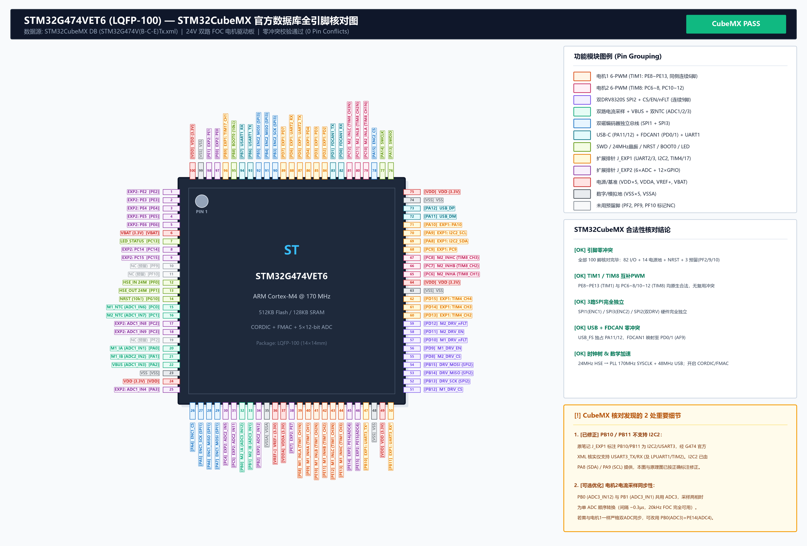
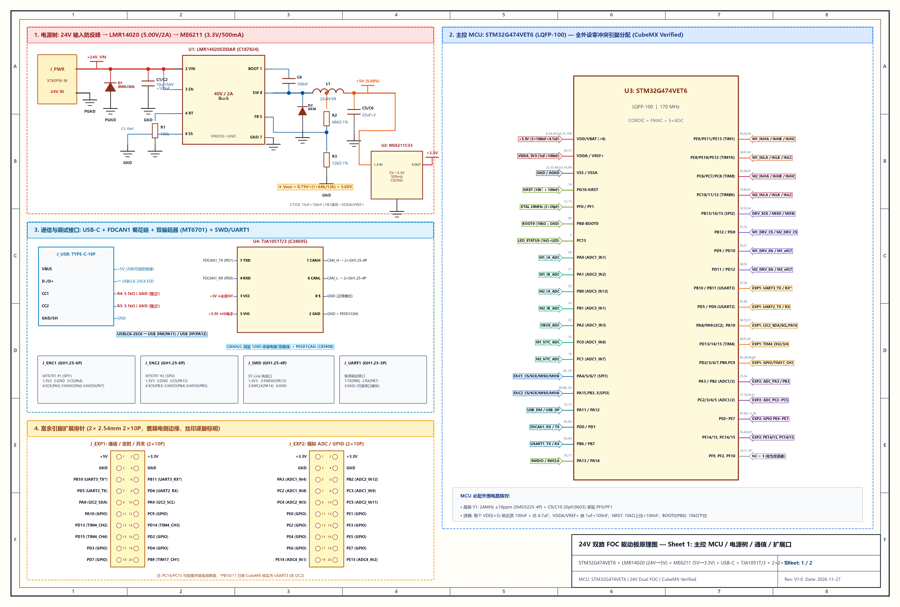
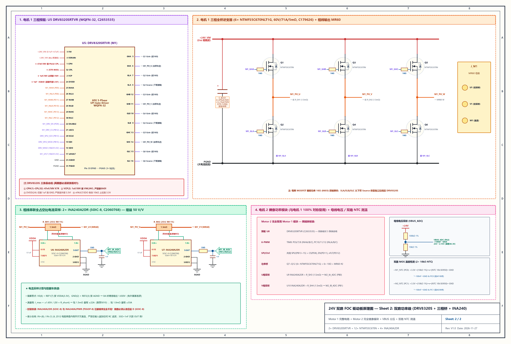
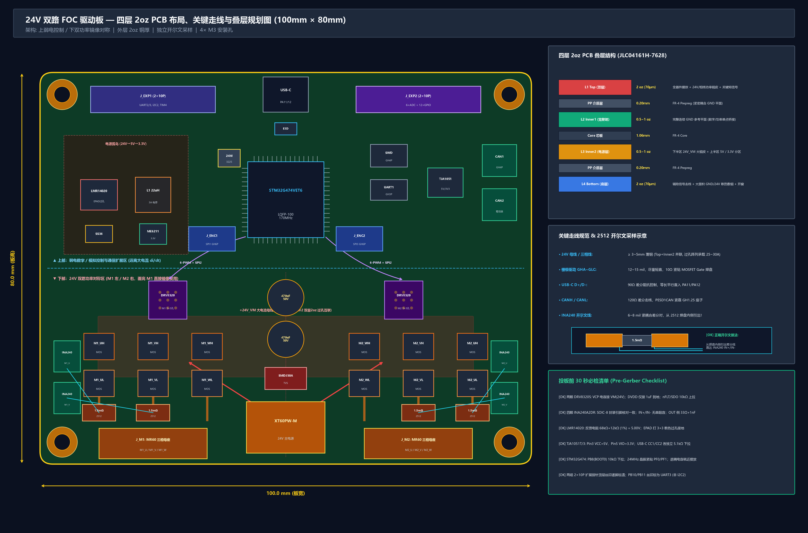

# STM32G474VET6 双路 FOC 原理图 / PCB 图纸与 CubeMX 引脚核对

> **日期**：2026-11-27  
> **关联设计文档**：[24V 双路 FOC 电机驱动板设计笔记（STM32G474VET6 旗舰版）](../2026-11-26-g474vet6-dual-foc-driver/README.md)  
> **核对范围**：`STM32G474VET6` (LQFP-100) 官方数据库全引脚校验、双页原理图及四层 2oz PCB 布局规划

---

## 1. STM32CubeMX 工程文件与核对说明

- **STM32CubeMX 工程文件**：[`CubeMX/G474_Dual_FOC.ioc`](./CubeMX/G474_Dual_FOC.ioc)（已对照 `STM32G474V(B-C-E)Tx.xml` 官方数据库完成 100 脚零冲突校验）
- **核对补充说明**：
  1. `PB10 / PB11` 在 STM32G474 上仅支持 `USART3 / LPUART1 / TIM2`，不支持 `I2C2`（`I2C2` 由 `PA8 / PA9` 提供），相关文档与图纸均已修正。
  2. 电机 2 电流采样 `PB0 (ADC3_IN12)` 与 `PB1 (ADC3_IN1)` 共用 `ADC3`（顺序采样间隔约 0.3µs，20kHz FOC 可用）；如需与电机 1 一样双 ADC 严格同步，可将其中一相换至 `PE14 (ADC4_IN1)` / `PE15 (ADC4_IN2)`。

---

## 2. 配套图纸

### 2.1 STM32CubeMX 全引脚核对图（LQFP-100）

### 2.2 原理图 Sheet 1：主控 MCU / 电源树 / 通信 / 扩展排针

### 2.3 原理图 Sheet 2：双路 FOC 功率驱动级（DRV8320S + 三相桥 + INA240）

### 2.4 四层 2oz PCB 布局、关键走线与叠层规划图

